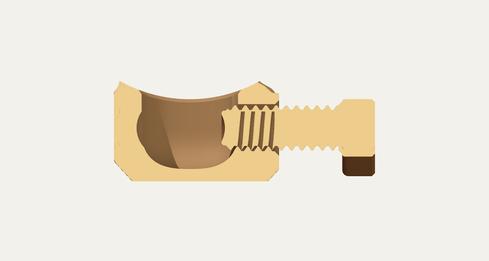
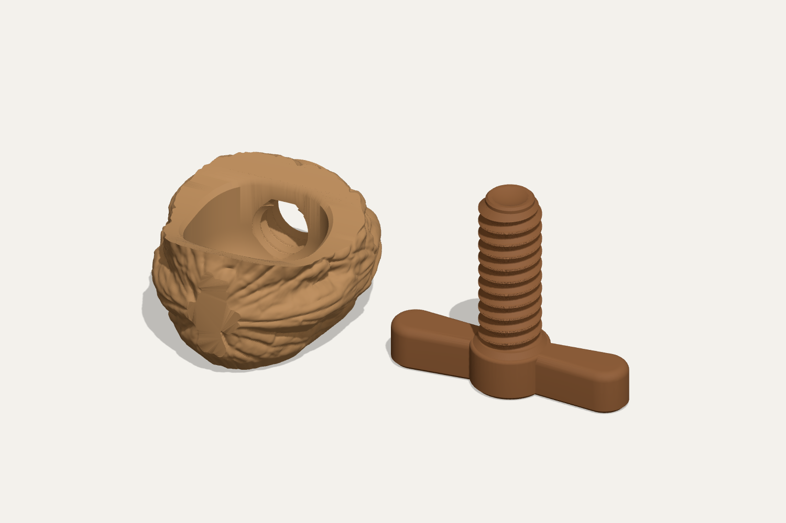
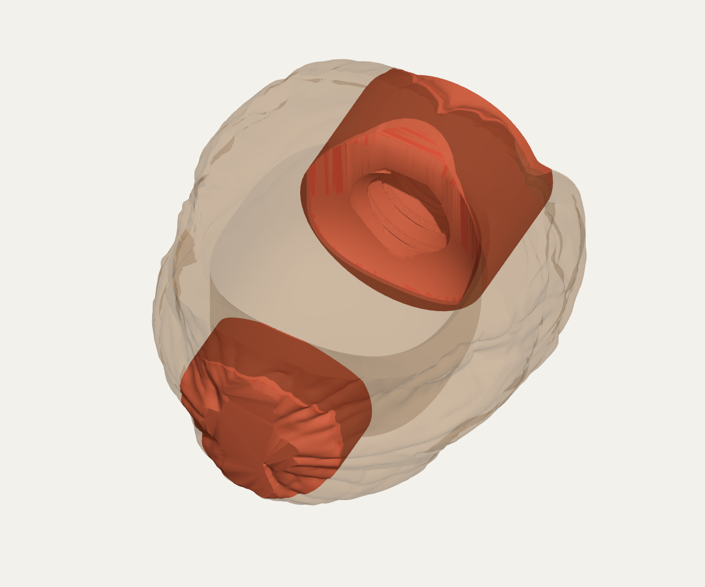

# Walnuss-Nussknacker – liegend druckbar

Ein Schraub-Nussknacker in Walnussform. Der Körper wird **auf dem Rücken liegend**
gedruckt, damit die Kraft beim Knacken *entlang* der Drucklagen läuft und die
Lagen nicht auseinanderzieht.


## Warum liegend?

Beim Knacken drückt die Schraube die Nuss gegen den Amboss. Die Gegenkraft
zieht den Körper zwischen Gewinde und Amboss auseinander – also genau entlang
der Schraubenachse.

- **Stehend gedruckt** liegen die Lagen quer zur Schraube: Die Zugkraft trennt
  Lage von Lage, die schwächste Richtung eines FDM-Drucks.
- **Liegend gedruckt** liegt die Schraubenachse in der Druckebene: Die Zugkraft
  läuft durch die durchgehenden Bahnen der Seitenwände. Auch die Zähne des
  Innengewindes entstehen so als durchgehende Bahnen.



Die Schraube steht beim Druck auf ihrem Griff. Sie wird nur auf Druck belastet,
das presst die Lagen zusammen; der Griff wird in der Lagenebene gebogen.

## Dateien

| Datei | Inhalt |
|---|---|
| `nussknacker_bambu_a1.3mf` | Bambu-Studio-Projekt: beide Teile fertig ausgerichtet, Infill-Modifier eingebaut |
| `stl/nussknacker_koerper.stl` | Körper, liegt bereits auf dem Rücken (74,9 × 80,5 × 49,0 mm) |
| `stl/nussknacker_schraube.stl` | Schraube, steht bereits auf dem Griff (88 × 28 × 74,8 mm) |
| `stl/modifier_*.stl` | Die drei Modifier-Körper einzeln, falls das 3MF nicht passt |
| `nutcracker.py` | Parametrischer Generator für alles oben |
| `walnut_relief.npz` | Reliefkarte der Schale, aus dem 3D-Scan einer echten Walnuss |
| `tools/scan_to_relief.py` | Erzeugt die Reliefkarte aus dem Scan (OBJ) |

## Druck (Bambu Lab A1, 0,4-mm-Düse)



| Einstellung | Wert |
|---|---|
| Ausrichtung | wie geliefert – nicht drehen |
| Schichthöhe | 0,20 mm |
| Wandlinien | 5 |
| Deck-/Bodenschichten | 5 / 5 |
| Füllung | 25 % Gyroid (Schraube 30 %) |
| Modifier | 100 %, Muster „Geradlinig“ |
| Stützen | **aus** |
| Rand (Brim) | nicht nötig |
| Material | PLA; PETG geht auch |

Verbrauch laut Test-Slice: Körper rund 95 g, Schraube rund 39 g.

### Die Modifier (mehr Füllung an den kritischen Stellen)



Drei Bereiche werden massiv gedruckt:

- **Gewindeblock** – Ring um das Innengewinde, dort wird die ganze Kraft eingeleitet
- **Amboss** – Block hinter der Mulde, auf die die Nuss drückt
- **Schaft** der Schraube

Im 3MF sind sie schon eingetragen. Mit den einzelnen STL geht es so:
Körper laden → Rechtsklick → *Modifizierer hinzufügen* → *Laden…* → Modifier-STL
wählen → für den Modifier *Fülldichte 100 %* und Muster *Geradlinig* setzen.
Die Modifier-STL liegen im selben Koordinatensystem wie das jeweilige Teil; falls
Bambu Studio sie beim Laden verschiebt, Position auf die des Teils setzen.

### Hinweise

- Im liegenden Gewindeloch gibt es oben ein kleines flaches Dach (9 mm Brücke).
  Das druckt ohne Stützen. Die Gewindegänge sind dort bewusst weggelassen, damit
  durchhängendes Material das Gewinde nicht klemmen lässt.
- Die Unterseite der Nuss läuft als flacher Kegel (43°) zum Bett – deshalb
  braucht auch die Außenhaut keine Stützen.
- Gewindespiel: 0,35 mm radial. Läuft die Schraube zu stramm, die Schraube im
  Slicer in X/Y auf 98–99 % skalieren (Z bei 100 % lassen).
- Ein Tropfen Speiseöl am Gewinde macht das Drehen leichter.

## Benutzung

Am stabilsten liegt der Nussknacker auf seinem flachen Rücken – die Kammer ist
dann eine Schale, in der die Schalenstücke bleiben. Nuss einlegen, Schraube im
Uhrzeigersinn drehen, bis es knackt. Er lässt sich auch aufrecht halten; am
runden Ende ist eine kleine Standfläche.

- Öffnung: 47 mm breit, bis 47 mm zwischen Amboss und Schraube (Walnüsse bis etwa 44 mm)
- kleinste Öffnung: rund 8 mm (Haselnüsse)
- Gewinde: 22 mm, Steigung 5 mm, Rechtsgewinde

## Anpassen

```bash
pip install -r requirements.txt
python3 nutcracker.py          # schreibt stl/ und nussknacker_bambu_a1.3mf
```

Alle Maße stehen oben in `nutcracker.py` in der Klasse `Params` – zum Beispiel
`cav_w`/`cav_len` (Kammer), `clearance` (Gewindespiel) oder `relief_gain`
(wie kräftig das Schalenrelief ausfällt; 1 = wie gescannt, voreingestellt 1,25).

Die Schale kommt aus `walnut_relief.npz`. Eine andere Nuss lässt sich so einlesen:

```bash
python3 tools/scan_to_relief.py walnut.obj walnut_relief.npz
```

Fehlt die Karte, rechnet der Generator ersatzweise ein künstliches Relief.

## Stand der Prüfung

Rechnerisch geprüft:

- Netze geschlossen, je ein zusammenhängender Körper
- Schraube läuft kollisionsfrei über den ganzen Verfahrweg (0,76 mm Axialspiel)
- Mindestwand um das Gewinde 5,5 mm, um die Nusskammer mindestens 4 mm (am Rand
  5 mm, auf Achshöhe über 10 mm), Rückwand 6 mm
- Außenhaut ohne Überhang über 45°; steilere Flächen gibt es nur an den
  Gewindeflanken der Schraube (55°) und als Brücke im Gewindeloch
- Test-Slice mit PrusaSlicer: Schraube ohne Stützmaterial, Körper nur im
  Gewindeloch; die Modifier wirken an der vorgesehenen Stelle

Noch offen:

- **Kein Probedruck.** Passung und Leichtgängigkeit des Gewindes zeigen sich erst am Drucker.
- Das 3MF wurde nicht in Bambu Studio selbst geöffnet (nur als 3MF-Geometrie
  gegengelesen). Falls Bambu Studio die Modifier nicht übernimmt, die STL-Dateien nehmen.

## Herkunft und Lizenz

Die Konstruktion ist neu. Die Idee – Walnussform mit Schraube von oben – stammt vom
[Walnut-shaped Nutcracker](https://www.printables.com/model/1491974-walnut-shaped-nutcracker)
von buchnema auf Printables; Geometrie von dort wurde nicht übernommen.

Die Schalenoberfläche (Naht, Rippen, Furchen) stammt aus dem
[Walnut 3D scan](https://www.printables.com/model/214774-walnut-3d-scan) von **DocMike**,
lizenziert unter [CC BY-NC-SA 4.0](https://creativecommons.org/licenses/by-nc-sa/4.0/).
Der Scan wurde ausgerichtet, vergrößert und als Relief auf die Form des Nussknackers
gelegt. Damit stehen `walnut_relief.npz`, die STL-Dateien und das 3MF ebenfalls unter
CC BY-NC-SA 4.0: Weitergabe nur mit Nennung von DocMike, nicht kommerziell und unter
derselben Lizenz.
