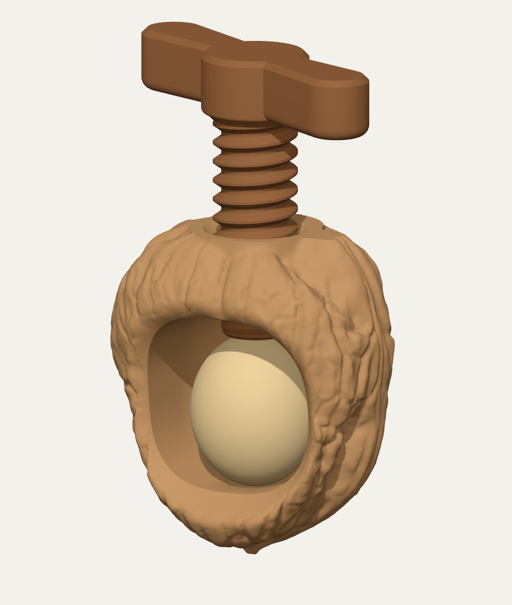
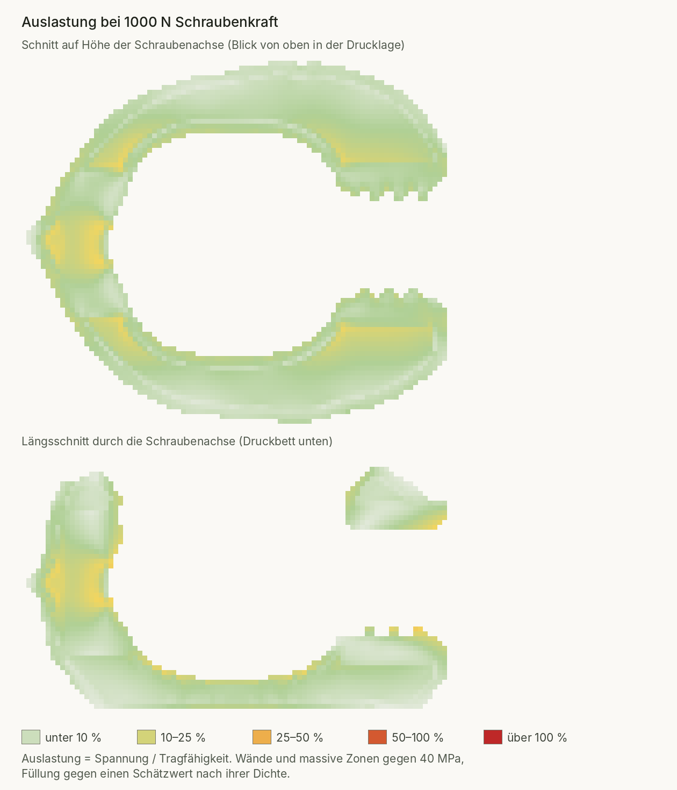
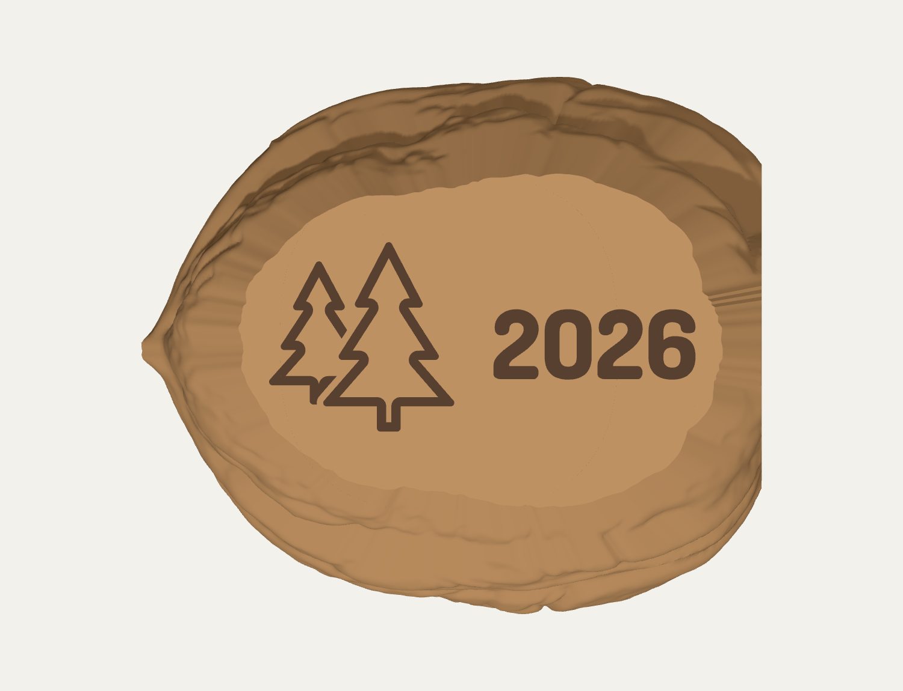

# Walnuss-Nussknacker – liegend druckbar

Ein Schraub-Nussknacker in Walnussform. Der Körper wird **auf dem Rücken liegend**
gedruckt, damit die Kraft beim Knacken *entlang* der Drucklagen läuft und die
Lagen nicht auseinanderzieht.



## Warum liegend?

Beim Knacken drückt die Schraube die Nuss gegen den Amboss. Die Gegenkraft
zieht den Körper zwischen Gewinde und Amboss auseinander – also genau entlang
der Schraubenachse.

- **Stehend gedruckt** liegen die Lagen quer zur Schraube: Die Zugkraft trennt
  Lage von Lage, die schwächste Richtung eines FDM-Drucks.
- **Liegend gedruckt** liegt die Schraubenachse in der Druckebene: Die Zugkraft
  läuft durch die durchgehenden Bahnen der Seitenwände. Auch die Zähne des
  Innengewindes entstehen so als durchgehende Bahnen.


Die Schraube steht beim Druck auf ihrem Griff. Sie wird nur auf Druck belastet,
das presst die Lagen zusammen; der Griff wird in der Lagenebene gebogen.

## Dateien

| Datei | Inhalt |
|---|---|
| `nussknacker_bambu_a1.3mf` | Bambu-Studio-Projekt: beide Teile fertig ausgerichtet, Infill-Modifier eingebaut |
| `stl/nussknacker_koerper.stl` | Körper, liegt bereits auf dem Rücken (74,9 × 86,3 × 51,3 mm) |
| `stl/nussknacker_schraube.stl` | Schraube, steht bereits auf dem Griff (88 × 28 × 74,8 mm) |
| `stl/modifier_*.stl` | Die drei Modifier-Körper einzeln, falls das 3MF nicht passt |
| `nutcracker.py` | Parametrischer Generator für alles oben |
| `walnut_relief.npz` | Reliefkarte der Schale, aus dem 3D-Scan einer echten Walnuss |
| `tools/scan_to_relief.py` | Erzeugt die Reliefkarte aus dem Scan (OBJ) |
| `gravur.json` | Motiv der Gravur auf der Rückseite |
| `tools/make_gravur.py` | Erzeugt die Gravur aus Bildvorlage, Text und Schrift |
| `tools/festigkeit.py` | Festigkeitsabschätzung (FEM für den Körper, Handrechnung für die Schraube) |

## Druck (Bambu Lab A1, 0,4-mm-Düse)


| Einstellung | Wert |
|---|---|
| Ausrichtung | wie geliefert – nicht drehen |
| Schichthöhe | 0,20 mm |
| Wandlinien | Körper 5, Schraube 4 |
| Deck-/Bodenschichten | 5 / 5 |
| Füllung | 25 % Gyroid |
| Modifier | 100 %, Muster „Geradlinig“ |
| Stützen | **aus** |
| Rand (Brim) | nicht nötig |
| Material | PLA; PETG geht auch |

Verbrauch laut Test-Slice: Körper rund 91 g, Schraube rund 40 g.

### Die Modifier (massive Zonen)


Drei Bereiche werden massiv gedruckt, alles andere mit 25 %:

- **Gewindehülse** – 5 mm stark um das Innengewinde. Sie stützt die Gewindezähne
  und verteilt ihre Last; der Block dahinter ist kaum belastet und braucht keine
  100 %.
- **Ambossblock** – 30 mm Durchmesser, 12 mm tief hinter der Mulde. Hier drückt
  die Nuss punktförmig, und das Ambossende ist die am höchsten belastete Zone.
- **Schaft der Schraube** – von der Spitze bis 8 mm in den Griff hinein. Beim
  Drehen entsteht Schub zwischen den Lagen; massiv ist er halb so groß wie mit
  Wänden und 25 % Füllung.

Im 3MF sind sie schon eingetragen. Mit den einzelnen STL geht es so:
Körper laden → Rechtsklick → *Modifizierer hinzufügen* → *Laden…* → Modifier-STL
wählen → für den Modifier *Fülldichte 100 %* und Muster *Geradlinig* setzen.
Die Modifier-STL liegen im selben Koordinatensystem wie das jeweilige Teil; falls
Bambu Studio sie beim Laden verschiebt, Position auf die des Teils setzen.

## Festigkeit



Gerechnet ist mit `tools/festigkeit.py`: der Körper als Voxel-FEM (Wände und
Deckschichten massiv, Füllung als weicheres Ersatzmaterial), die Schraube von Hand.

**Lasten (Annahmen).** Eine Walnuss bricht meist bei 300–600 N, harte Nüsse
brauchen bis etwa 1000 N. Dafür muss man mit 5 Nm drehen. Ein sehr kräftiger Griff schafft etwa
10 Nm – das sind rund 2000 N bei trockenem und 2900 N bei geöltem Gewinde.

**Körper bei 1000 N** (99,5-%-Werte in MPa; Festigkeit in der Lagenebene rund
40 MPa, zwischen den Lagen rund 20 MPa):

| | **jetzt** | sparsam | zu knapp |
|---|---|---|---|
| Wände / Füllung | **5 / 25 %** | 4 / 25 % | 3 / 30 % |
| Seitenwände | **9,9** | 11,5 | 13,4 |
| Ambossende | **7,9** | 9,3 | 10,4 |
| Gewindeblock | **6,8** | 7,4 | 7,5 |
| Zug zwischen den Lagen | **4,3** | 4,6 | 4,8 |
| Schub zwischen den Lagen | **3,1** | 3,5 | 3,8 |
| Füllung, Auslastung | **28 %** | 31 % | 28 % |
| Gewicht (Test-Slice) | **91 g** | 86 g | 85 g |

Alle drei Varianten haben dieselben massiven Zonen (Hülse und Ambossblock). Größere
100-%-Blöcke bringen kaum etwas: Sie senken die Spannung in den Seitenwänden nur
um 2 %.

Am höchsten belastet sind die Seitenwände am Kammerrand und das Ambossende, nicht
das Gewinde. Die Last tragen die Wandlinien: Die fünfte Wand kostet knapp 5 g und
senkt die Spannung an der schwächsten Stelle um 13 %. Mit 4 Wänden hält der Körper
rechnerisch auch (3,5-fache statt 4,0-fache Sicherheit bei 1000 N), mit 3 Wänden
käme er bei 2900 N nah an die Festigkeitsgrenze.

**Schraube.** Der Schaft ist das am knappsten ausgelegte Teil: Bei 10 Nm entstehen
massiv 9 MPa Schub zwischen den Lagen, mit 4 Wänden und 25 % Füllung wären es
15 MPa. Der Griff ist unkritisch (Nabe 5,6 MPa bei 10 Nm), dort reichen 4 Wände
und 25 %.

Das sind Abschätzungen. Materialkennwerte und vor allem die Tragfähigkeit der
Füllung sind grobe Annahmen, die Druckqualität streut, und Kerben feiner als 1 mm
erfasst das Modell nicht.

### Hinweise

- Im liegenden Gewindeloch gibt es oben ein kleines flaches Dach (9 mm Brücke).
  Das druckt ohne Stützen. Die Gewindegänge laufen zum Dach hin sanft aus, damit
  dort keine frei hängenden Zahnstummel entstehen und nichts klemmt. Auch an beiden
  Enden des Lochs und zur Spitze der Schraube hin laufen die Gänge über eine
  Drittel- bis gut eine halbe Windung aus.
- Um die Kammeröffnung läuft die Nussschale bis an eine 50° steile Schräge. Eine
  flache Fläche gibt es dort nicht, deshalb zeichnen sich oben keine
  Treppenstufen ab. Der Grat zwischen Schräge und Schale ist gerundet, und die
  Kammerkante liegt zum runden Ende hin am tiefsten.
- Die Unterseite der Nuss läuft als flacher Kegel (43°) zum Bett – deshalb
  braucht auch die Außenhaut keine Stützen.
- Gewindespiel: 0,35 mm radial. Läuft die Schraube zu stramm, die Schraube im
  Slicer in X/Y auf 98–99 % skalieren (Z bei 100 % lassen).
- Ein Tropfen Speiseöl am Gewinde macht das Drehen leichter.

## Gravur auf der Rückseite



Auf der flachen Rückseite – der Seite, die auf dem Druckbett liegt – sind links
zwei Tannenbäume in zwei Größen – die kleine steht versetzt hinter der großen –
und rechts daneben, mittig dazu, die Jahreszahl 2026, 0,6 mm tief graviert. Im Bild sind die Rillen
dunkel hervorgehoben; im Druck haben sie die Farbe des Körpers. Gelesen wird von
außen, die Schraube zeigt dabei nach rechts.

Die Bäume sind als Kontur graviert, nicht als Fläche. So ist jede Rille
höchstens 1,3 mm breit (die Ziffern rund 2 mm), und die vierte Schicht überbrückt sie sauber. Eine
flächige Vertiefung müsste dicht über dem heißen Bett weit überbrückt werden und
würde unsauber.

Für eine saubere Gravur das Bett vorher reinigen und die erste Schicht nicht zu
schnell drucken.

Das Motiv liegt in `gravur.json`. Mit einer anderen Jahreszahl neu erzeugen:

```bash
pip install pillow contourpy
python3 tools/make_gravur.py "2027" /pfad/zur/Schrift.otf gravur.json
python3 nutcracker.py
```

Als Schrift ist Dosis ExtraBold verwendet (der Punkt in ihrer Null wird
weggelassen). Ohne Gravur drucken: in `nutcracker.py`
den Wert `engraving` auf `""` setzen.

## Benutzung

Am stabilsten liegt der Nussknacker auf seinem flachen Rücken – die Kammer ist
dann eine Schale, in der die Schalenstücke bleiben. Nuss einlegen, Schraube im
Uhrzeigersinn drehen, bis es knackt. Aufrecht steht er nicht von selbst: Am
runden Ende sitzt die Spitze der Nuss. Wer eine Standfläche möchte, setzt in
`nutcracker.py` den Wert `stand_flat_y` (zum Beispiel `-40.5`).

- Öffnung: 47 mm breit, bis 47 mm zwischen Amboss und Schraube (Walnüsse bis etwa 44 mm)
- kleinste Öffnung: rund 8 mm (Haselnüsse)
- Gewinde: 22 mm, Steigung 5 mm, Rechtsgewinde

## Anpassen

```bash
pip install -r requirements.txt
python3 nutcracker.py          # schreibt stl/ und nussknacker_bambu_a1.3mf
```

Alle Maße stehen oben in `nutcracker.py` in der Klasse `Params` – zum Beispiel
`cav_w`/`cav_len` (Kammer), `clearance` (Gewindespiel) oder `relief_gain`
(wie kräftig das Schalenrelief ausfällt; 1 = wie gescannt, voreingestellt 1,25).

Die Schale kommt aus `walnut_relief.npz`. Eine andere Nuss lässt sich so einlesen:

```bash
python3 tools/scan_to_relief.py walnut.obj walnut_relief.npz
```

Fehlt die Karte, rechnet der Generator ersatzweise ein künstliches Relief.

## Stand der Prüfung

Rechnerisch geprüft:

- Netze geschlossen, je ein zusammenhängender Körper
- Schraube läuft kollisionsfrei über den ganzen Verfahrweg (0,84 mm Axialspiel).
  Gegenüber dem ersten Probedruck, bei dem das Gewinde gut lief, hat es in jede
  Richtung gleich viel oder etwas mehr Spiel; die tragende Flankenfläche beträgt
  rund drei Viertel davon (4,8 MPa Flächenpressung bei 1000 N)
- Mindestwand um das Gewinde 5,5 mm, um die Nusskammer mindestens 4 mm (auf
  Achshöhe über 10 mm), Rückwand 6 mm
- Außenhaut ohne Überhang über 45°; steilere Flächen gibt es nur an den
  Gewindeflanken der Schraube (55°), als Brücke im Gewindeloch und über den
  schmalen Rillen der Gravur
- Festigkeit gerechnet (siehe oben): bei 1000 N höchstens 10 MPa in den Wänden
  und 4,3 MPa zwischen den Lagen
- Test-Slice mit PrusaSlicer: Schraube ohne Stützmaterial, Körper nur im
  Gewindeloch; die Modifier wirken an der vorgesehenen Stelle; die Gravur bleibt in den ersten
  drei Schichten frei und wird darüber überbrückt

Noch offen:

- **Kein Probedruck.** Passung und Leichtgängigkeit des Gewindes zeigen sich erst am Drucker.
- Das 3MF wurde nicht in Bambu Studio selbst geöffnet (nur als 3MF-Geometrie
  gegengelesen). Falls Bambu Studio die Modifier nicht übernimmt, die STL-Dateien nehmen.

## Herkunft und Lizenz

Die Konstruktion ist neu. Die Idee – Walnussform mit Schraube von oben – stammt vom
[Walnut-shaped Nutcracker](https://www.printables.com/model/1491974-walnut-shaped-nutcracker)
von buchnema auf Printables; Geometrie von dort wurde nicht übernommen.

Die Schalenoberfläche (Naht, Rippen, Furchen) stammt aus dem
[Walnut 3D scan](https://www.printables.com/model/214774-walnut-3d-scan) von **DocMike**,
lizenziert unter [CC BY-NC-SA 4.0](https://creativecommons.org/licenses/by-nc-sa/4.0/).
Der Scan wurde ausgerichtet, vergrößert und als Relief auf die Form des Nussknackers
gelegt. Damit stehen `walnut_relief.npz`, die STL-Dateien und das 3MF ebenfalls unter
CC BY-NC-SA 4.0: Weitergabe nur mit Nennung von DocMike, nicht kommerziell und unter
derselben Lizenz.
